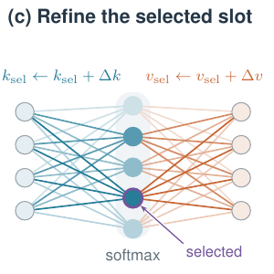
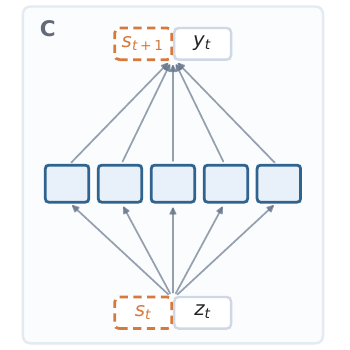
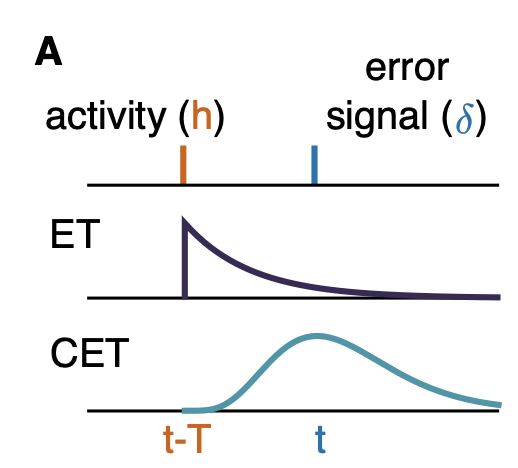
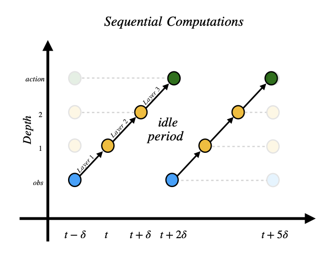

## Selected publications

  
  

  
[Fast Weights Recurrent Transformer](https://openreview.net/forum?id=Sl5mOMfm8R)

  
**Ivan Anokhin**, Daria Yasafova, Tianyu Zhao, Irina Rish, Sebastian Risi

  
 NeurIPS 2026 Workshop: Long-Context Foundation Models 

  
[[PDF](files/fast-weights-recurrent-transformer.pdf)]

  
We introduce a recurrent Transformer with learned, sparse updates to a fixed-size key-value memory. Compared with FIFO-based recurrent Transformers, it improves FineWeb language modeling at small memory sizes, learns associative recall faster, and improves needle-in-a-haystack retrieval.

  

  
  

  
[Temporal Recurrence Favors Fewer Layers](https://arxiv.org/abs/2609.12531)

  
**Ivan Anokhin**, Johan Obando-Ceron, Irina Rish, Sebastian Risi

  
 Preprint, 2026 

  
[[PDF](https://arxiv.org/pdf/2609.12531), [Code](https://github.com/avecplezir/fewer-layers-with-rec)]

  
We study how temporal recurrence changes the best allocation of compute along three axes: depth, width, and the number of experts. On Sokoban and FineWeb language modeling, the best observed recurrent models use substantially fewer layers with comparable or better performance under approximately the same per-step compute.

  

  
  

  
[Learning From the Past with Cascading Eligibility Traces](https://arxiv.org/abs/2506.14598)

  
Tokiniaina Raharison Ralambomihanta\*, **Ivan Anokhin**\*, Roman Pogodin\*, Samira Ebrahimi Kahou, Jonathan Cornford, Blake Aaron Richards

  
 ICLR 2026 

  
[[PDF](https://arxiv.org/pdf/2506.14598), [Code](https://github.com/avecplezir/CET), [Poster](images/pubs/cet_poster.png)]

  
We show how to handle delayed credit assignment in an online, bio-plausible fashion by employing SSMs to retain past activations. We demonstrate the applicability of our method on computer vision and RL tasks. The design is friendly to on-device learning and Streaming RL. 

  

  
  

  
[Handling Delay in Real-Time Reinforcement Learning](https://arxiv.org/abs/2503.23478)

  
**Ivan Anokhin**, Rishav Rishav, Matthew Riemer, Stephen Chung, Irina Rish, Samira Ebrahimi Kahou

  
 ICLR 2025 

  
 [[PDF](https://arxiv.org/pdf/2503.23478), [Code](https://github.com/avecplezir/realtime-agent), [Blog post](https://mila.quebec/en/article/real-time-reinforcement-learning), [Poster](images/pubs/realtime_poster.png)] 

  
We address real-time RL by pipelining layer computations and handling observation delay. We show it leads to faster inference and competitive performance on MuJoCo and MinAtar. The design is also friendly to on-device inference.

  

## All publications
::: {#refs}
:::
